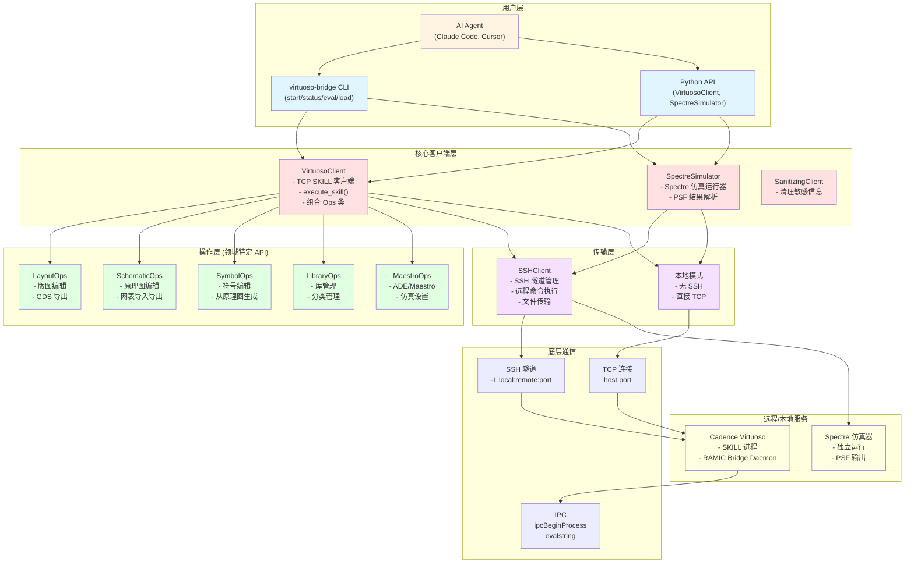
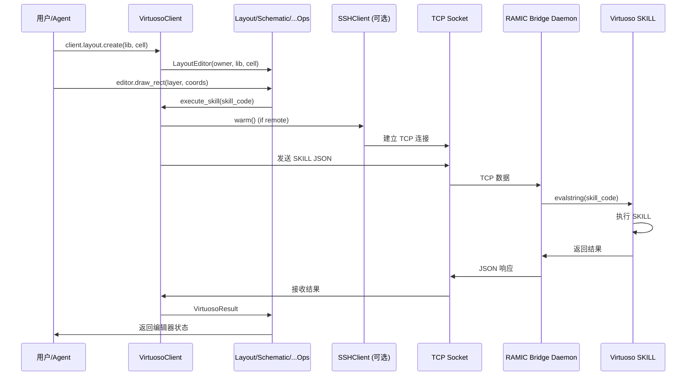
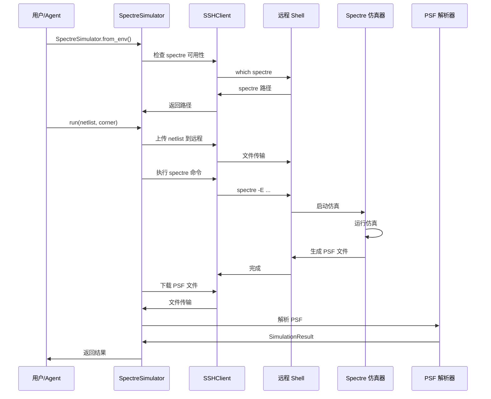
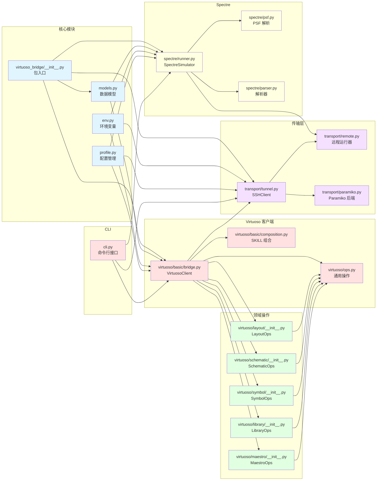
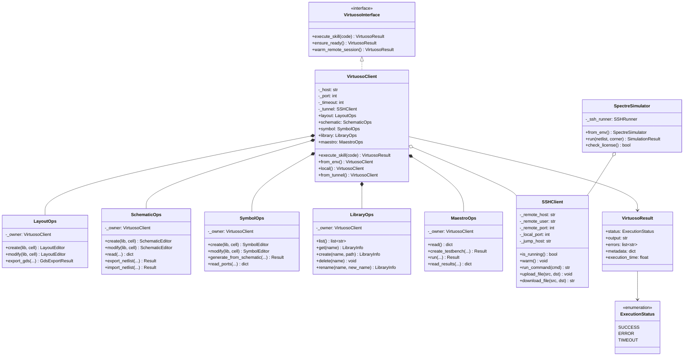
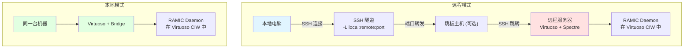
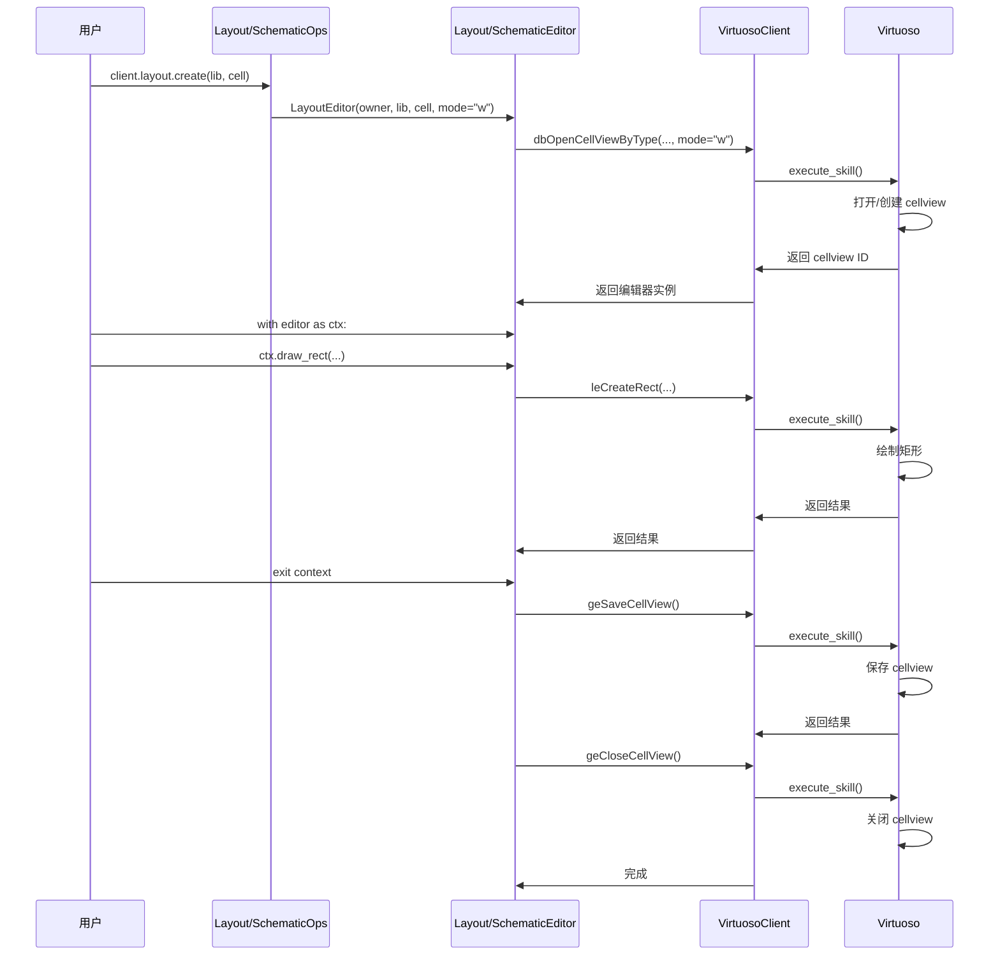
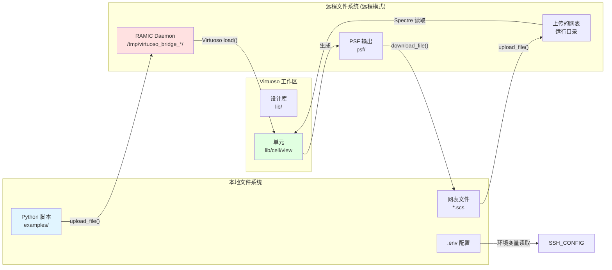

# Virtuoso-Bridge-Lite 完整架构图

## 整体架构

## 数据流详解

### SKILL 执行流程

### Spectre 仿真流程

## 模块依赖关系

## 核心类关系图

## 远程 vs 本地模式对比

## 编辑器上下文管理器流程

## 文件系统映射

## 关键设计模式

### 1. 组合模式 (Composition Pattern)
- `VirtuosoClient` 组合了多个 Ops 类
- 每个 Ops 类持有 `VirtuosoClient` 的引用
- 实现了职责分离和模块化

### 2. 工厂模式 (Factory Pattern)
- `VirtuosoClient.from_env()` - 从环境变量创建
- `VirtuosoClient.local()` - 本地模式创建
- `VirtuosoClient.from_tunnel()` - 从隧道创建

### 3. 上下文管理器 (Context Manager)
- `LayoutEditor` / `SchematicEditor` / `SymbolEditor`
- 自动管理 cellview 的打开、保存、关闭

### 4. 策略模式 (Strategy Pattern)
- SSH 后端选择 (OpenSSH vs Paramiko)
- 传输策略（远程 vs 本地）

## 核心文件说明

| 文件 | 职责 | 关键类/函数 |
|------|------|------------|
| `virtuoso_bridge/__init__.py` | 包入口 | 导出核心类 |
| `virtuoso_bridge/models.py` | 数据模型 | VirtuosoResult, ExecutionStatus |
| `virtuoso_bridge/env.py` | 环境变量 | load_vb_env() |
| `virtuoso_bridge/profile.py` | 配置管理 | resolve_profile() |
| `virtuoso/basic/bridge.py` | 核心客户端 | VirtuosoClient |
| `virtuoso/ops.py` | 通用操作 | open_cell_view, save_cell_view |
| `virtuoso/layout/__init__.py` | 版图操作 | LayoutOps, LayoutEditor |
| `virtuoso/schematic/__init__.py` | 原理图操作 | SchematicOps, SchematicEditor |
| `virtuoso/symbol/__init__.py` | 符号操作 | SymbolOps, SymbolEditor |
| `virtuoso/library/__init__.py` | 库管理 | LibraryOps |
| `virtuoso/maestro/__init__.py` | ADE/Maestro | MaestroOps |
| `transport/tunnel.py` | SSH 隧道 | SSHClient |
| `transport/remote.py` | 远程运行 | SSHRunner |
| `spectre/runner.py` | Spectre 仿真 | SpectreSimulator |
| `spectre/psf.py` | PSF 解析 | parse_psf() |
| `cli.py` | 命令行接口 | main() |

---

**注意**：这些 Mermaid 图表可以使用支持 Mermaid 的 Markdown 查看器（如 GitHub、VS Code with Mermaid 插件、Typora 等）来渲染。
